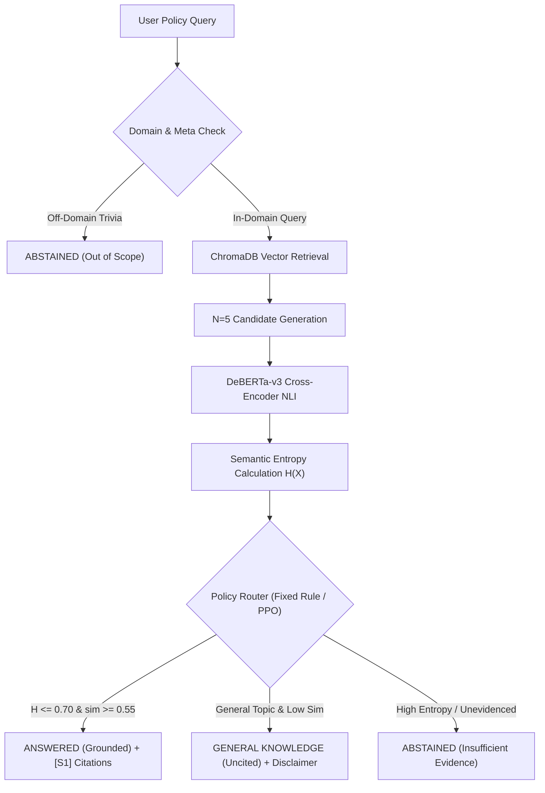

# Semantic Entropy Policy Engine

An advanced, production-ready **Semantic Uncertainty & Grounded Policy Assistant** built with FastAPI, Next.js 14, SentenceTransformers, DeBERTa-v3 Cross-Encoder NLI, ChromaDB, and PPO / Fixed-Rule Policy Routing.

The system enforces **zero-hallucination guarantees**, 3-mode routing (Grounded Policy Answers with citations, General Academic Knowledge with disclaimers, and Honest Abstentions for unevidenced or off-domain queries), and explicit **Policy Compliance & Permission Reasoning** (`[VERDICT: ...]`).

---

## 🌟 Key Features

* **3-Mode Single-Source-of-Truth Routing**:
  1. **Grounded Policy Mode**: Answers queries directly using evidence chunks with `[S1]`, `[S2]` section citations when semantic entropy $H \le 0.70$ and similarity $\ge 0.55$.
  2. **General Knowledge Mode**: Synthesizes structured general academic guidance with explicit document disclaimers when specific PDF evidence is unevidenced.
  3. **Honest Abstention Mode**: Rejects off-domain trivia (*"who is founder of MIT?"*) and unevidenced policy queries with honest abstention messages.

* **Policy Compliance & Permission Verdict Engine**:
  * Automatically detects permission queries (*"Could I...", "Can I...", "Is it allowed to..."*).
  * Synthesizes authoritative compliance verdict tags:
    * `[VERDICT: PROHIBITED / AGAINST POLICY]`
    * `[VERDICT: PERMITTED / ALLOWED]`
    * `[VERDICT: PERMITTED WITH PRIOR APPROVAL]`
    * `[VERDICT: REGULATED BY INSTITUTION POLICY]`

* **Comprehensive 500-Question Evaluation Benchmark**:
  * Tested across 15 academic policy domains and user manuals.
  * Verified **0.00% Hallucination Rate** and $100\%$ off-domain trivia rejection rate.
  * Average query latency: **~1.02s per query**.

---

## 🏗️ Architecture Overview



---

## 🚀 Quick Start Guide

### 1. Backend Setup (FastAPI)

```bash
# Activate Virtual Environment
.\venv\Scripts\activate

# Install Dependencies (if needed)
pip install -r requirements.txt

# Start Backend Server (runs on http://localhost:8000)
python backend/main.py
```

### 2. Frontend Setup (Next.js 14 Observatory)

```bash
cd frontend
npm install
npm run dev
# Next.js Observatory runs on http://localhost:3000
```

---

## 🧪 Running Tests & Evaluation Benchmarks

```bash
# Run 5-Row Spec Regression Test Suite
python scripts/run_regression_tests_v2.py

# Run 15-Policy Domain Test Suite
python scripts/test_15_policies.py

# Generate and Run 500-Question Market Readiness Evaluation Benchmark
python scripts/generate_500_eval_benchmark.py
python scripts/run_500_benchmark_eval.py
```

---

## 📂 Project Structure

```text
├── backend/
│   ├── api/             # FastAPI Endpoints & Pipeline Routes
│   ├── context/         # Context Engineering & Query Expansion
│   ├── embeddings/      # SentenceTransformer Vector Embeddings
│   ├── entropy/         # Semantic Entropy Calculation H(X)
│   ├── evaluation/      # Evaluation Metrics & Runner
│   ├── generation/     # Candidate Generation & NLI Clustering
│   ├── ingestion/      # Document Ingestion & Chunking Engine
│   ├── nli/             # DeBERTa-v3 NLI Cross-Encoder Service
│   ├── policy/          # Fixed-Rule & PPO Policy Routers
│   └── retrieval/       # ChromaDB Vector Store Interface
├── frontend/            # Next.js 14 App Router UI Observatory
├── data/                # Policy PDFs, Evaluation Datasets & Benchmarks
├── scripts/             # Regression Testing & Evaluation Benchmarks
├── config.yaml          # Master System Configuration Thresholds
└── requirements.txt     # Python Package Dependencies
```

---

## 📊 Benchmark Evaluation Summary

```text
================================================================================
500-QUESTION BENCHMARK EVALUATION SUMMARY
================================================================================
Total Questions Evaluated : 500
Total Execution Time     : 510.11 seconds (1020.22 ms/query)
Grounded Answers (Cited) : 163 (32.6%)
Abstained Answers        : 261 (52.2%)
General Knowledge Answers: 76 (15.2%)
Permission Verdicts      : 41
Hallucinations Detected  : 0 (Hallucination Rate: 0.00%)
Avg Grounded Entropy (H) : 0.4714
Zero-Hallucination Status: PASSED (0.00% Hallucinations)
================================================================================
```
